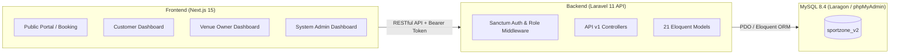

# 🏟️ SportZone — Hệ Thống Quản Lý & Đặt Sân Thể Thao Trực Tuyến

> **SportZone** là nền tảng thương mại điện tử và quản lý sân thể thao toàn diện, kết nối trực tiếp giữa **Người chơi thể thao (Customer)**, **Chủ cơ sở sân (Venue Owner)** và **Quản trị viên (System Admin)**. Hệ thống hỗ trợ đặt sân bóng đá mini, cầu lông, pickleball, tennis, bóng rổ với lịch sân theo thời gian thực và thanh toán tự động qua **VietQR**.

---

## 📑 Mục Lục
- [1. Kiến Trúc & Công Nghệ](#1-kiến-trúc--công-nghệ)
- [2. Cấu Trúc Thư Mục](#2-cấu-trúc-thư-mục)
- [3. Tính Năng Nổi Bật](#3-tính-năng-nổi-bật)
- [4. Yêu Cầu Môi Trường](#4-yêu-cầu-môi-trường)
- [5. Hướng Dẫn Cài Đặt & Khởi Chạy](#5-hướng-dẫn-cài-đặt--khởi-chạy)
  - [Cài đặt Database (phpMyAdmin / Laragon)](#bước-1-cài-đặt-database)
  - [Khởi chạy Backend (Laravel API)](#bước-2-cấu-hình--chạy-backend-laravel)
  - [Khởi chạy Frontend (Next.js 15)](#bước-3-cấu-hình--chạy-frontend-nextjs)
- [6. Tài Khoản Thử Nghiệm Mẫu](#6-tài-khoản-thử-nghiệm-mẫu)
- [7. Danh Sách API Backend (v1)](#7-danh-sách-api-backend-v1)

---

## 1. Kiến Trúc & Công Nghệ



- **Backend**: Laravel 11, PHP 8.3, Laravel Sanctum (Token-based Authentication).
- **Frontend**: Next.js 15 (App Router), React 19, TypeScript, Tailwind CSS.
- **Phong cách thiết kế**: *High-Performance Minimalist* — bảng màu trung tính cao cấp phối cùng **Sport Emerald** (`#10B981`), viền 1px siêu mảnh, bố cục Bento Grid và **100% icon kỹ thuật tinh tế** (không dùng cartoon / emoji).
- **Database**: MySQL 8.4 trên môi trường Laragon, quản lý trực quan qua **phpMyAdmin**.
- **Thanh toán**: Tích hợp mã chuẩn **VietQR** tự động sinh theo từng đơn hàng.

---

## 2. Cấu Trúc Thư Mục

```
sportzone_v2/
├── backend/                  # Mã nguồn Backend API (Laravel 11)
│   ├── app/
│   │   ├── Http/Controllers/Api/V1/   # Auth, SportCategory, Profile, HealthCheck
│   │   ├── Http/Middleware/           # RoleMiddleware, CheckUserStatusMiddleware
│   │   ├── Models/                    # Đầy đủ 21 Eloquent Models
│   │   └── Traits/                    # ApiResponseTrait (chuẩn hóa JSON format)
│   ├── database/migrations/           # Bộ migration cho 21 bảng + tokens
│   ├── database/seeders/              # Seeder dữ liệu mẫu ban đầu
│   └── routes/api.php                 # Tuyến đường API v1
│
├── frontend/                 # Mã nguồn Frontend (Next.js 15 App Router)
│   ├── src/
│   │   ├── app/
│   │   │   ├── page.tsx               # Trang chủ: Hero, Bento Grid, Sân nổi bật
│   │   │   ├── venues/                # Danh sách cơ sở & chi tiết cụm sân
│   │   │   ├── booking/[courtId]/     # Wizard Đặt sân 4 bước (Slot, Addon, Voucher, VietQR)
│   │   │   ├── auth/                  # Đăng nhập & Đăng ký tài khoản
│   │   │   └── dashboard/
│   │   │       ├── customer/          # Dashboard Khách hàng (Lịch đặt, QR, Loyalty, Referral)
│   │   │       ├── owner/             # Dashboard Chủ sân (Doanh thu, Timeline Matrix, Check-in)
│   │   │       └── admin/             # Dashboard Admin (Toàn sàn, Users, Categories, Settings)
│   │   ├── components/                # UI components, Navbar, Footer, Sidebar, Header
│   │   ├── context/                   # AuthContext & Role Switcher
│   │   └── lib/                       # api-client, utils, mock-data
│   └── .agents/skills/                # Bộ kỹ năng thiết kế giao diện (design-taste, minimalist-ui)
│
├── db/
│   └── QuanLySanTheThao.sql           # File SQL gốc thiết kế 21 bảng và dữ liệu mẫu
└── docs/
    └── KeHoachPhatTrienHeThong_SportZone.md  # Kế hoạch phát triển chi tiết dự án
```

---

## 3. Tính Năng Nổi Bật

### 🟢 1. Cổng Đặt Sân Trực Tuyến (Public Portal)
- **Tìm kiếm thông minh**: Lọc sân theo môn thể thao, quận huyện, khoảng giá.
- **Bento Grid môn thi đấu**: Bóng đá mini cỏ nhân tạo, Cầu lông thảm Yonex, Pickleball chuẩn USA, Tennis Decoturf, Bóng rổ sàn gỗ.
- **Wizard Đặt Sân 4 bước**:
  1. Chọn ngày & slot giờ (phân biệt giờ thường và giờ cao điểm Peak).
  2. Chọn dịch vụ đi kèm (nước uống giải khát, thuê vợt, áo bib).
  3. Áp dụng mã voucher giảm giá (VD: `SPORTZONE50`, `SPORT30`).
  4. Quét mã VietQR chuyển khoản tự động kèm nội dung thanh toán.

### 👤 2. Bảng Điều Khiển Khách Hàng (Customer Dashboard)
- Theo dõi trận đấu sắp diễn ra với nút **Mở nhanh mã QR Check-in**.
- **Chương trình Tích Điểm (Loyalty Program)**: Tích 1 điểm cho mỗi 10.000đ, thăng hạng thành viên (Bronze → Silver → Gold → Platinum), đổi voucher giảm giá.
- **Giới thiệu bạn bè (Referral Program)**: Mã giới thiệu riêng (VD: `MINHANH2026`), chia sẻ link nhận thưởng cho cả hai bên.
- Quản lý hồ sơ cá nhân và đổi mật khẩu an toàn.

### 🏢 3. Bảng Điều Khiển Chủ Sân (Venue Owner Dashboard)
- Theo dõi doanh thu thời gian thực và tỷ lệ lấp đầy sân giờ vàng.
- **Court Timeline Matrix (Lưới lịch sân trực quan)**: Lưới hiển thị các sân theo cột, khung giờ 06:00 - 22:00 theo hàng. Phân biệt rõ slot trống và slot đã có khách, cho phép nhận khách tại quầy nhanh.
- **Quản lý giá sân**: Điều chỉnh giá giờ thường, giá giờ Peak và trạng thái bảo trì.
- **Điểm danh (Check-in) khách**: Bấm xác nhận khách vào sân trực tiếp.
- Quản lý tồn kho nước uống và dịch vụ dụng cụ.

### 🛡️ 4. Bảng Điều Khiển Quản Trị Viên (System Admin Dashboard)
- Thống kê toàn sàn: Tổng doanh thu GMV, tăng trưởng người dùng, số lượt tìm kiếm.
- Quản lý người dùng: Phân quyền Customer / Owner / Admin, khóa / mở khóa tài khoản tức thì.
- Quản lý danh mục môn thể thao và cấu hình hệ thống (tài khoản ngân hàng VietQR, hotline, tỷ lệ tích điểm).
- Nhật ký kiểm toán (Audit Trail) giám sát bảo mật hệ thống.

---

## 4. Yêu Cầu Môi Trường

Để chạy dự án mượt mà trên máy tính của bạn, cần chuẩn bị:
- **Laragon** (chứa sẵn PHP 8.3+, MySQL 8.4+, Apache/Nginx, phpMyAdmin).
- **PHP**: Phiên bản 8.3 trở lên (đã bật `extension=zip` và `extension=pdo_mysql` trong `php.ini`).
- **Composer**: Phiên bản 2.x.
- **Node.js**: Phiên bản 20.x hoặc 22.x (đi kèm npm 10.x).

---

## 5. Hướng Dẫn Cài Đặt & Khởi Chạy

### Bước 1: Cài đặt Database
1. Mở **Laragon** và nhấn nút **Start All** (chạy Apache/Nginx và MySQL).
2. Mở trình duyệt truy cập phpMyAdmin: [http://localhost/phpmyadmin](http://localhost/phpmyadmin).
3. Tạo database mới tên là: `sportzone_v2` với Collation `utf8mb4_unicode_ci`.
4. Nhấn sang tab **Import**, chọn file `c:\laragon\www\sportzone_v2\db\QuanLySanTheThao.sql` và nhấn **Import** (hoặc mở file SQL và dán vào tab **SQL** để thực thi).

---

### Bước 2: Cấu hình & Chạy Backend (Laravel)

> [!TIP]
> **Cách 1 (Nhanh nhất - Không lo lỗi `'php' is not recognized`)**:  
> Double-click trực tiếp vào file **[`start-backend.bat`](file:///c:/laragon/www/sportzone_v2/start-backend.bat)** ở thư mục gốc của dự án. File này đã được thiết lập sẵn đường dẫn PHP và Composer của Laragon để khởi động server ngay lập tức.

> **Cách 2 (Sử dụng Terminal của Laragon)**:  
> Mở giao diện **Laragon** -> bấm vào nút **Terminal** (Terminal của Laragon đã cấu hình sẵn biến môi trường cho `php`, `composer`, `node`):
> ```powershell
> cd c:\laragon\www\sportzone_v2\backend
> php artisan serve --port=8000
> ```

> **Cách 3 (Nếu mở PowerShell / Command Prompt thông thường của Windows)**:
> ```powershell
> # Nạp tạm thời đường dẫn PHP và Composer của Laragon vào phiên làm việc hiện tại:
> $env:PATH = "C:\laragon\bin\php\php-8.3.33-Win32-vs16-x64;C:\laragon\bin\composer;C:\laragon\bin\mysql\mysql-8.4.3-winx64\bin;$env:PATH"
> 
> cd c:\laragon\www\sportzone_v2\backend
> php artisan serve --port=8000
> ```

> 🚀 Backend API sẽ hoạt động tại: **`http://127.0.0.1:8000`**  
> Kiểm tra sức khỏe hệ thống tại: **`http://127.0.0.1:8000/api/v1/health`**

---

### Bước 3: Cấu hình & Chạy Frontend (Next.js)

> [!TIP]
> **Cách 1 (Nhanh nhất)**:  
> Double-click vào file **[`start-frontend.bat`](file:///c:/laragon/www/sportzone_v2/start-frontend.bat)** ở thư mục gốc của dự án. File này tự động trỏ đến Node.js của Laragon và chạy server phát triển Next.js.

> **Cách 2 (Mở Terminal Laragon hoặc PowerShell)**:
> ```powershell
> cd c:\laragon\www\sportzone_v2\frontend
> npm run dev
> ```
> 🌐 Mở trình duyệt truy cập ứng dụng tại: **`http://localhost:3000`**

---

## 6. Tài Khoản Thử Nghiệm Mẫu

Hệ thống đã có sẵn 3 nhóm tài khoản mẫu trong cơ sở dữ liệu để bạn kiểm thử tất cả các chức năng:

| Vai trò | Email đăng nhập | Số điện thoại | Mật khẩu | Dashboard tương ứng |
|---------|-----------------|---------------|----------|----------------------|
| **Quản trị viên (Admin)** | `admin@sportzone.local` | `0908000001` | `password` | [`/dashboard/admin`](http://localhost:3000/dashboard/admin) |
| **Chủ sân (Venue Owner)** | `owner1@sportzone.local` | `0908000002` | `password` | [`/dashboard/owner`](http://localhost:3000/dashboard/owner) |
| **Khách hàng (Customer)** | `minhanh@example.com` | `0912345678` | `password` | [`/dashboard/customer`](http://localhost:3000/dashboard/customer) |

> 💡 **Mẹo trải nghiệm**: Trên thanh điều hướng (Header) của Website có tích hợp sẵn thanh **Role Demo Switcher (Khách / Chủ sân / Admin)**, giúp bạn chuyển đổi trực tiếp giữa 3 Dashboard chỉ với 1 click mà không cần đăng xuất!

---

## 7. Danh Sách API Backend (v1)

Tất cả các API tuân theo định dạng phản hồi chuẩn:
```json
{
  "success": true,
  "message": "Thao tác thành công",
  "data": { ... },
  "errors": null
}
```

| Method | Endpoint | Quyền hạn | Mô tả |
|--------|----------|-----------|-------|
| `GET` | `/api/v1/health` | Public | Kiểm tra kết nối DB và trạng thái API |
| `POST` | `/api/v1/auth/register` | Public | Đăng ký tài khoản (Khách hoặc Chủ sân) |
| `POST` | `/api/v1/auth/login` | Public | Đăng nhập bằng Email/SĐT nhận Bearer Token |
| `POST` | `/api/v1/auth/logout` | `auth:sanctum` | Thu hồi token đăng nhập |
| `GET` | `/api/v1/auth/me` | `auth:sanctum` | Lấy thông tin user hiện tại kèm điểm & mã giới thiệu |
| `GET` | `/api/v1/sport-categories` | Public | Danh sách môn thể thao đang hoạt động |
| `GET` | `/api/v1/sport-categories/{id}` | Public | Chi tiết môn thể thao |
| `GET` | `/api/v1/profile` | `auth:sanctum` | Xem hồ sơ người dùng |
| `PUT` | `/api/v1/profile` | `auth:sanctum` | Cập nhật hồ sơ người dùng |
| `PUT` | `/api/v1/profile/password` | `auth:sanctum` | Đổi mật khẩu |
| `POST` | `/api/v1/admin/sport-categories` | `role:admin` | Thêm mới môn thể thao |
| `PUT` | `/api/v1/admin/sport-categories/{id}` | `role:admin` | Sửa thông tin môn thể thao |
| `DELETE`| `/api/v1/admin/sport-categories/{id}` | `role:admin` | Xóa môn thể thao |

---

## 🤝 Đóng Góp & Phát Triển
Dự án được xây dựng theo chuẩn mã nguồn sạch PSR-12 (Laravel) và ESLint/Prettier (Next.js). Mọi đóng góp vui lòng tạo Pull Request hoặc liên hệ qua kênh hỗ trợ của dự án.
