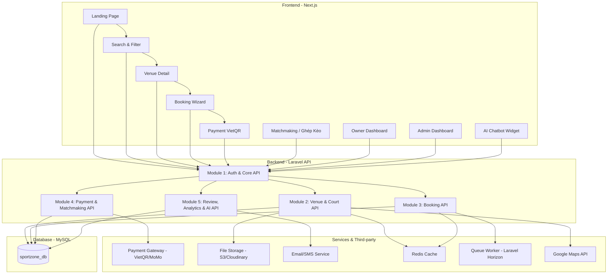

# 🏟️ SportZone — Kế Hoạch Phát Triển Hệ Thống Quản Lý & Đặt Sân Thể Thao

> **Tech Stack**: Laravel (Backend API) · Next.js (Frontend) · MySQL/phpMyAdmin (Database) · Laragon (Local Dev)
> **Mục tiêu**: Production-ready — Hệ thống thương mại điện tử đặt sân thể thao trực tuyến
> **Ngày tạo**: 2026-09-17

---

## Quy Ước Mức Độ Ưu Tiên

| Icon | Mức độ | Ý nghĩa |
|------|--------|----------|
| 🔴 | **Critical** | Bắt buộc hoàn thành, hệ thống không chạy được nếu thiếu |
| 🟠 | **High** | Rất quan trọng, ảnh hưởng trực tiếp đến trải nghiệm chính |
| 🟡 | **Medium** | Cần có nhưng có thể hoàn thành sau core features |
| 🟢 | **Low** | Nice-to-have, làm khi còn thời gian hoặc phase sau |

---

## 📊 Phân Tích Database — Tổng Quan Entities

Dựa trên file [`QuanLySanTheThao.sql`](../db/QuanLySanTheThao.sql), hệ thống gồm **21 bảng** (15 bảng gốc + 6 bảng bổ sung cho AI features):

### Bảng gốc (Core)

| # | Bảng | Mô tả | Quan hệ chính |
|---|------|--------|----------------|
| 1 | `users` | Người dùng (customer / owner / admin) | Trung tâm hệ thống |
| 2 | `sport_categories` | Danh mục môn thể thao (Bóng đá, Cầu lông, Pickleball...) | → courts, match_posts |
| 3 | `venues` | Cơ sở / Cụm sân thể thao | → owner (users), courts |
| 4 | `venue_amenities` | Tiện ích của cơ sở (wifi, gửi xe, tắm nóng lạnh...) | → venues |
| 5 | `courts` | Sân cụ thể (tên, loại mặt sân, giá giờ thường/peak...) | → venues, sport_categories |
| 6 | `addons` | Dịch vụ đi kèm (nước uống, thuê vợt, trọng tài...) | → booking_addons |
| 7 | `vouchers` | Mã giảm giá (fixed/percent, hạn dùng, giới hạn số lần) | → bookings |
| 8 | `bookings` | Đơn đặt sân chính (ngày, giờ, phí, trạng thái, thanh toán) | → users, venues, courts, vouchers |
| 9 | `booking_addons` | Chi tiết dịch vụ đi kèm của đơn đặt | → bookings, addons |
| 10 | `payments` | Lịch sử giao dịch thanh toán | → bookings, users |
| 11 | `booking_status_history` | Lịch sử thay đổi trạng thái đơn đặt | → bookings, users |
| 12 | `match_posts` | Bài đăng tìm đối / ghép kèo | → users, sport_categories, venues |
| 13 | `match_members` | Thành viên tham gia kèo | → match_posts, users |
| 14 | `reviews` | Đánh giá & nhận xét cơ sở | → venues, users, bookings |
| 15 | `audit_logs` | Nhật ký hành động hệ thống | → users |
| 16 | `system_settings` | Cấu hình hệ thống (tên, hotline, bank...) | Độc lập |

### Bảng bổ sung (AI Features & Nâng cao)

| # | Bảng | Mô tả | Phục vụ tính năng |
|---|------|--------|-------------------|
| 17 | `notifications` | Thông báo in-app, email, SMS, push + Smart Reminder (`scheduled_at`) | Smart Reminder |
| 18 | `user_points` | Điểm tích lũy & hạng thành viên (bronze → silver → gold → platinum) | Loyalty Program |
| 19 | `point_transactions` | Lịch sử tích/đổi/hết hạn điểm | Loyalty Program |
| 20 | `referral_codes` | Mã giới thiệu unique cho mỗi user | Referral Program |
| 21 | `referral_rewards` | Tracking thưởng cho người giới thiệu & người được giới thiệu | Referral Program |
| 22 | `user_search_history` | Lịch sử tìm kiếm, click, conversion — data cho AI gợi ý | AI Recommendation |
| 23 | `social_accounts` | Liên kết tài khoản mạng xã hội (Google, Facebook) cho OAuth2 login | OAuth2 Social Login |

---

## 🔍 Phân Tích Nghiệp Vụ & Chức Năng

### 1. 👤 Quản Lý Người Dùng & Xác Thực

| Chức năng | Mô tả | Dựa trên DB |
|-----------|--------|-------------|
| Đăng ký tài khoản | Hỗ trợ 3 role: customer, owner, admin | `users.role` |
| Đăng nhập / Đăng xuất | JWT / Session-based auth | `users.password_hash`, `last_login_at` |
| OAuth2 Social Login | Đăng nhập bằng Google, Facebook (Laravel Socialite) | `social_accounts` |
| Liên kết tài khoản MXH | 1 user có thể liên kết nhiều tài khoản social | `social_accounts.provider`, `provider_id` |
| Quản lý profile | Cập nhật thông tin, avatar | `users.full_name`, `avatar` |
| Khóa/mở tài khoản | Admin quản lý trạng thái user | `users.status` (active/blocked) |
| Phân quyền 3 tầng | Customer → Owner → Admin | `users.role` ENUM |

---

### 2. 🏢 Quản Lý Cơ Sở & Sân

| Chức năng | Mô tả | Dựa trên DB |
|-----------|--------|-------------|
| CRUD cơ sở (Venue) | Tạo/sửa/xóa cơ sở thể thao | `venues` |
| Quản lý tiện ích | Thêm wifi, gửi xe, tắm nóng lạnh... | `venue_amenities` |
| CRUD sân (Court) | Quản lý từng sân riêng biệt | `courts` |
| Phân loại mặt sân | Cỏ nhân tạo, thảm Yonex, Acrylic... | `courts.surface_type` |
| Giá giờ thường / peak | Tự động áp giá theo khung giờ | `hourly_rate_standard`, `hourly_rate_peak` |
| Trạng thái sân | Active / Maintenance / Closed | `courts.status` |
| Tìm kiếm sân theo vị trí | Hỗ trợ lat/lng | `venues.latitude`, `longitude` |
| Danh mục thể thao | Quản lý các môn | `sport_categories` |

---

### 3. 📅 Đặt Sân (Booking) — Nghiệp Vụ Lõi

| Chức năng | Mô tả | Dựa trên DB |
|-----------|--------|-------------|
| Đặt sân online | Chọn ngày, giờ, sân → tạo đơn | `bookings` |
| Đặt sân tại quầy | Nhân viên tạo đơn trực tiếp | `bookings.source` (counter) |
| Đặt sân qua admin | Admin tạo thay khách | `bookings.source` (admin) |
| Kiểm tra slot trống | Real-time check lịch sân | `idx_booking_slot` index |
| Thêm dịch vụ đi kèm | Nước, vợt, trọng tài... | `booking_addons`, `addons` |
| Áp mã giảm giá | Validate và tính discount | `vouchers`, `bookings.voucher_id` |
| Tính phí tự động | court_fee + addons_fee - discount = total | `bookings` (các field fee) |
| Lifecycle đơn đặt | pending → confirmed → completed / cancelled / no_show | `bookings.status` |
| Check-in | Xác nhận khách đến sân | `bookings.checked_in`, `checked_in_at` |
| Hủy đơn | Ghi lý do hủy | `cancelled_at`, `cancel_reason` |
| Lịch sử trạng thái | Log mọi thay đổi trạng thái | `booking_status_history` |
| Booking cho khách vãng lai | Không cần tài khoản | `bookings.user_id` NULL |

---

### 4. 💳 Thanh Toán

| Chức năng | Mô tả | Dựa trên DB |
|-----------|--------|-------------|
| Thanh toán VietQR | Quét mã QR chuyển khoản | `payment_method` = 'vietqr' |
| Thanh toán MoMo | Ví điện tử MoMo | `payment_method` = 'momo' |
| Thanh toán tiền mặt | Tại quầy | `payment_method` = 'cash' |
| Chuyển khoản ngân hàng | Bank transfer | `payment_method` = 'bank_transfer' |
| Thanh toán một phần | Đặt cọc trước | `payment_status` = 'partial' |
| Hoàn tiền | Khi hủy đơn | `payment_status` = 'refunded' |
| Lịch sử giao dịch | Log mọi giao dịch | `payments` table |

---

### 5. ⭐ Đánh Giá & Nhận Xét

| Chức năng | Mô tả | Dựa trên DB |
|-----------|--------|-------------|
| Đánh giá sân | Rating 1-5 sao + comment | `reviews` |
| Liên kết booking | Review gắn với đơn đặt đã hoàn thành | `reviews.booking_id` |
| Ẩn/hiện review | Quản lý nội dung review | `reviews.status` (visible/hidden) |
| Rating trung bình | Tự động cập nhật | `venues.rating`, `review_count` |

---

### 6. 🎟️ Mã Giảm Giá & Khuyến Mãi

| Chức năng | Mô tả | Dựa trên DB |
|-----------|--------|-------------|
| CRUD voucher | Tạo/sửa/xóa mã giảm giá | `vouchers` |
| Fixed / Percent | Giảm cố định hoặc theo % | `discount_type` |
| Giới hạn sử dụng | Số lần dùng tối đa | `usage_limit`, `used_count` |
| Thời hạn hiệu lực | Ngày bắt đầu - kết thúc | `starts_at`, `ends_at` |
| Đơn tối thiểu | Yêu cầu giá trị đơn tối thiểu | `min_order_value` |

---

### 7. 📊 Báo Cáo & Thống Kê (Dashboard)

| Chức năng | Mô tả | Dựa trên DB |
|-----------|--------|-------------|
| Doanh thu theo ngày/tuần/tháng | Tổng hợp từ payments | `payments`, `bookings` |
| Thống kê booking | Số đơn, tỷ lệ hoàn thành, hủy, no-show | `bookings.status` |
| Sân hot nhất | Sân được đặt nhiều nhất | Aggregate by `court_id` |
| Giờ cao điểm | Phân tích khung giờ hot | `start_time`, `end_time` |
| Audit log | Lịch sử hành động hệ thống | `audit_logs` |
| System settings | Cấu hình hệ thống | `system_settings` |

---

## 🤖 Cải Tiến AI & Nâng Cao (Đã Chọn Lọc)

> Chỉ giữ lại **6 tính năng** nâng cao khả thi trong timeline dự án:

| # | Tính năng | Mô tả | Áp dụng cho nghiệp vụ | Ưu tiên |
|---|-----------|--------|------------------------|---------|
| 1 | **AI Smart Search & Recommendation** | Gợi ý sân dựa trên lịch sử đặt, vị trí GPS, sở thích môn thể thao của user | Venue & Court | 🟠 High |
| 2 | **Google Maps Integration** | Hiển thị sân trên bản đồ, tính khoảng cách, chỉ đường đến sân | Venue & Court | 🟠 High |
| 3 | **AI Smart Booking Assistant (Chatbot)** | Chatbot AI hỗ trợ đặt sân bằng ngôn ngữ tự nhiên: _"Tìm sân bóng đá 5 người tối nay ở Tân Bình"_ | Booking | 🟡 Medium |
| 4 | **Smart Reminder** | Gửi nhắc nhở tự động trước giờ chơi qua SMS/Email/Push notification | Booking | 🟠 High |
| 5 | **Loyalty Program / Tích điểm** | Tích điểm mỗi lần đặt sân, đổi điểm lấy voucher, thăng hạng thành viên | Voucher & Khuyến mãi | 🟡 Medium |
| 6 | **Referral Program** | Giới thiệu bạn bè nhận ưu đãi cho cả người giới thiệu và người được giới thiệu | Voucher & Khuyến mãi | 🟡 Medium |

### Ghi chú triển khai:
- **Phase 1-3**: Tập trung hoàn thành core features trước
- **Phase 4**: Tích hợp Google Maps + Smart Reminder (🟠 High)
- **Phase 5**: AI Smart Search, Chatbot, Loyalty, Referral (🟡 Medium) — triển khai nếu kịp timeline

---

## 👥 Phân Chia 5 Phần Việc (5 Thành Viên / Modules)

> **Nguyên tắc**: Mỗi phần việc bao quát cả **Backend (Laravel API)** lẫn **Frontend (Next.js)** cho module tương ứng. Phần nền tảng chung (auth, base schema, deployment) do Thành viên 1 (Team Lead) chủ trì.

### Bảng Tổng Quan 5 Phần Việc

| Phần | Tên Module / Phân công | Vai trò chính | Các bảng DB phụ trách |
|:---:|---|---|---|
| **Phần 1** | **Core, Auth & Quản trị Hệ thống** *(Team Lead)* | Setup khung dự án, xác thực, phân quyền 3 tầng, cấu hình chung, quản trị người dùng. | `users`, `social_accounts`, `sport_categories`, `audit_logs`, `system_settings` |
| **Phần 2** | **Quản lý Cơ sở, Sân bãi & Bản đồ** | Khám phá sân, tìm kiếm, bộ lọc, chi tiết sân, tích hợp bản đồ & định vị GPS. | `venues`, `venue_amenities`, `courts`, `addons`, `user_search_history` |
| **Phần 3** | **Quy trình Đặt sân Lõi & Lịch trình** | Luồng đặt sân (wizard 4 bước), kiểm tra trùng slot, quản lý lịch biểu sân, check-in. | `bookings`, `booking_addons`, `booking_status_history` |
| **Phần 4** | **Thanh toán, Khuyến mãi & Ghép kèo** | Cổng thanh toán (VietQR/MoMo), mã giảm giá voucher, cộng đồng tìm đối / ghép kèo thể thao. | `payments`, `vouchers`, `match_posts`, `match_members` |
| **Phần 5** | **Đánh giá, Báo cáo & Tính năng Thông minh (AI/Loyalty)** | Review & rating, dashboard doanh thu/thống kê cho Owner & Admin, Chatbot AI & tích điểm. | `reviews`, `notifications`, `user_points`, `point_transactions`, `referral_codes`, `referral_rewards` |

---

### 👨‍💻 Phần 1 — Core, Auth & Quản Trị Hệ Thống (Team Lead)

> **Vai trò**: Team Lead, kiến trúc hệ thống, xác thực & quản lý người dùng
> **Bảng phụ trách**: `users`, `social_accounts`, `sport_categories`, `audit_logs`, `system_settings`

#### Backend (Laravel)

| Ưu tiên | Task |
|---------|------|
| 🔴 | Setup dự án Laravel, cấu hình project structure |
| 🔴 | Database migrations cho **tất cả** các bảng (base schema) |
| 🔴 | Authentication system (JWT / Laravel Sanctum) |
| 🔴 | Middleware phân quyền (customer / owner / admin) |
| 🔴 | Base Controller, Base Service, API Response format chuẩn |
| 🔴 | Error handling & validation rules |
| 🟠 | API: `users` — CRUD, profile, avatar upload |
| 🟠 | OAuth2 Social Login: Google (Laravel Socialite + Google API) |
| 🟠 | OAuth2 Social Login: Facebook (Laravel Socialite + Facebook API) |
| 🟠 | API: `sport_categories` — CRUD danh mục thể thao |
| 🟠 | CORS, Rate limiting, Security headers |
| 🟠 | Seeders & Factories cho test data |
| 🟡 | API: `system_settings` — Get/Update cấu hình |
| 🟡 | API: `audit_logs` — Ghi log & query |
| 🟡 | CI/CD pipeline setup (GitHub Actions) |
| 🟢 | Docker / Laragon config cho team |

#### Frontend (Next.js)

| Ưu tiên | Task |
|---------|------|
| 🔴 | Setup dự án Next.js, cấu hình project structure |
| 🔴 | Design System: Color tokens, Typography, Component library |
| 🔴 | Layout chính: Header, Sidebar, Footer |
| 🔴 | Trang Đăng ký / Đăng nhập / Quên mật khẩu |
| 🟠 | Nút "Đăng nhập bằng Google" / "Đăng nhập bằng Facebook" + OAuth2 flow |
| 🔴 | Middleware auth Next.js (protected routes) |
| 🟠 | Global state management (Zustand / Redux) |
| 🟠 | Trang Profile người dùng |
| 🟠 | Admin Panel: Quản lý người dùng |
| 🟡 | Admin Panel: Cấu hình hệ thống |
| 🟡 | Admin Panel: Xem audit logs |
| 🟡 | SEO config, meta tags, sitemap |
| 🟡 | Responsive layout mobile/tablet/desktop |
| 🟢 | Dark mode toggle |

---

### 👨‍💻 Phần 2 — Quản Lý Cơ Sở, Sân Bãi & Bản Đồ

> **Vai trò**: Quản lý cơ sở, sân, tiện ích, dịch vụ đi kèm + Tích hợp Maps & Bộ lọc
> **Bảng phụ trách**: `venues`, `venue_amenities`, `courts`, `addons`, `user_search_history`

#### Backend (Laravel)

| Ưu tiên | Task |
|---------|------|
| 🔴 | API: `venues` — CRUD, tìm kiếm, filter theo city/district/sport |
| 🔴 | API: `courts` — CRUD sân, filter theo venue/sport/status |
| 🔴 | API: Lịch sân (calendar view data cho từng court) |
| 🟠 | API: `venue_amenities` — CRUD tiện ích |
| 🟠 | API: `addons` — CRUD dịch vụ đi kèm của cơ sở |
| 🟠 | Slug generation cho venue |
| 🟠 | Image upload & optimization (S3 / Cloudinary) |
| 🟡 | Full-text search cho venues |
| 🟡 | Geolocation query (tìm sân gần nhất theo lat/lng) |
| 🟡 | Cache strategy cho venue listing (Redis) |
| 🟢 | 🤖 Google Maps Geocoding API integration (backend) |

#### Frontend (Next.js)

| Ưu tiên | Task |
|---------|------|
| 🔴 | Trang Landing / Homepage — Hero banner với search bar |
| 🔴 | Trang Landing / Homepage — Danh mục thể thao (cards) |
| 🔴 | Trang Landing / Homepage — Sân nổi bật / phổ biến |
| 🔴 | Trang Danh sách sân — Filter: Thành phố, Quận, Môn, Giá, Rating |
| 🔴 | Trang Danh sách sân — Sort, Grid/List view, Pagination |
| 🟠 | Trang Chi tiết sân — Gallery ảnh, thông tin cơ sở, tiện ích |
| 🟠 | Trang Chi tiết sân — Danh sách courts với giá |
| 🟠 | Owner Panel: Dashboard cơ sở |
| 🟠 | Owner Panel: Quản lý sân & tiện ích |
| 🟡 | Owner Panel: Quản lý dịch vụ đi kèm |
| 🟡 | Trang Landing / Homepage — CTA sections |
| 🟡 | 🤖 Google Maps embed trên trang chi tiết sân |
| 🟡 | 🤖 Trang Bản đồ tìm sân tương tác (Map view) |

---

### 👨‍💻 Phần 3 — Nghiệp Vụ Đặt Sân Lõi & Lịch Trình (Core Booking)

> **Vai trò**: Nghiệp vụ đặt sân cốt lõi, chống xung đột lịch, quản lý lịch biểu sân & check-in
> **Bảng phụ trách**: `bookings`, `booking_addons`, `booking_status_history`

#### Backend (Laravel)

| Ưu tiên | Task |
|---------|------|
| 🔴 | API: `bookings` — Tạo đơn, cập nhật, hủy, check-in |
| 🔴 | Booking validation: Kiểm tra slot trống, khóa chống trùng lịch (Concurrency Lock) |
| 🔴 | Tính phí tự động: court_fee (standard/peak) + addons_fee |
| 🔴 | API: `booking_addons` — Thêm/sửa/xóa dịch vụ đi kèm trong đơn |
| 🔴 | Generate booking_code unique |
| 🟠 | API: `booking_status_history` — Auto log khi status thay đổi |
| 🟠 | API: Lịch đặt sân dạng Calendar/Timeline cho chủ sân |
| 🟠 | API: Xác thực check-in cho khách đến sân |
| 🟡 | Auto-cancel job: Hủy đơn unpaid sau X phút (Laravel Queue) |
| 🟡 | Export booking report (PDF/Excel) |

#### Frontend (Next.js)

| Ưu tiên | Task |
|---------|------|
| 🔴 | Flow Đặt Sân — Step 1: Chọn ngày & khung giờ trống (Calendar + Time slots) |
| 🔴 | Flow Đặt Sân — Step 2: Chọn dịch vụ đi kèm (nước, bóng, vợt...) |
| 🔴 | Flow Đặt Sân — Step 3: Xác nhận thông tin người đặt & chi phí |
| 🟠 | Trang Lịch sử đặt sân (Customer) |
| 🟠 | Trang Chi tiết đơn đặt & trạng thái đơn |
| 🟠 | Owner Panel: Quản lý danh sách đơn đặt (list, filter, search) |
| 🟡 | Owner Panel: Calendar view sân (timeline giờ x ngày trực quan) |
| 🟡 | Owner Panel: Check-in khách (nhập mã đơn hoặc quét nhanh) |
| 🟡 | Real-time slot availability (polling/optimistic update) |

---

### 👨‍💻 Phần 4 — Thanh Toán, Khuyến Mãi & Ghép Kèo (Payment, Vouchers & Matchmaking)

> **Vai trò**: Cổng thanh toán, mã khuyến mãi, cộng đồng tìm đối và ghép kèo thể thao
> **Bảng phụ trách**: `payments`, `vouchers`, `match_posts`, `match_members`

#### Backend (Laravel)

| Ưu tiên | Task |
|---------|------|
| 🔴 | API: `payments` — Tạo giao dịch, cập nhật trạng thái thanh toán |
| 🔴 | Payment integration: Tự động sinh mã VietQR theo chuẩn Napas |
| 🔴 | API: `vouchers` — CRUD mã giảm giá, validate & áp dụng voucher vào đơn đặt |
| 🟠 | Webhook handler cho payment callback (MoMo/VNPay/VietQR) |
| 🟠 | Xử lý hoàn tiền / ghi nhận trạng thái thanh toán một phần |
| 🟠 | API: `match_posts` — CRUD bài đăng tìm đối, ghép kèo giao lưu |
| 🟠 | API: `match_members` — Quản lý đăng ký tham gia kèo, duyệt/từ chối thành viên |
| 🟡 | Lọc bài đăng ghép kèo theo môn thể thao, khu vực, trình độ |

#### Frontend (Next.js)

| Ưu tiên | Task |
|---------|------|
| 🔴 | Giao diện Thanh toán: Render mã VietQR động, countdown timer hết hạn thanh toán |
| 🔴 | Input áp mã voucher trong flow đặt sân & hiển thị mức giảm giá |
| 🟠 | Trang Trạng thái thanh toán (Thành công / Thất bại / Đang xử lý) |
| 🟠 | Trang Cộng đồng ghép kèo: Danh sách bài đăng tìm đối (filter theo môn, khu vực) |
| 🟠 | Trang Chi tiết kèo & Nút xin tham gia kèo / Danh sách người tham gia |
| 🟠 | Form tạo bài đăng tìm đối / ghép kèo mới |
| 🟡 | Owner Panel: Quản lý mã giảm giá (tạo mã, hạn sử dụng, lượt dùng) |

---

### 👨‍💻 Phần 5 — Đánh Giá, Báo Cáo & Tính Năng Thông Minh (AI & Loyalty)

> **Vai trò**: Đánh giá & nhận xét, dashboard thống kê kinh doanh, chatbot AI & loyalty
> **Bảng phụ trách**: `reviews`, `notifications`, `user_points`, `point_transactions`, `referral_codes`, `referral_rewards`

#### Backend (Laravel)

| Ưu tiên | Task |
|---------|------|
| 🔴 | API: `reviews` — CRUD đánh giá, phân trang review theo cơ sở |
| 🔴 | Auto update `venues.rating` & `review_count` khi có review mới |
| 🔴 | Review validation: chỉ review sau khi đơn đặt đã completed |
| 🟠 | API: Dashboard thống kê doanh thu theo ngày/tuần/tháng/năm |
| 🟠 | API: Dashboard thống kê top sân, khung giờ cao điểm, tỷ lệ hoàn thành/hủy |
| 🟡 | Notification system (Database notification + Email thông báo) |
| 🟡 | 🤖 Smart Reminder: Cron job gửi nhắc nhở trước giờ chơi (Email/SMS) |
| 🟡 | 🤖 Loyalty Program: API tích điểm sau mỗi đơn thành công, đổi điểm nhận voucher |
| 🟡 | 🤖 Referral Program: API tạo mã giới thiệu, tracking và phát thưởng |
| 🟢 | 🤖 AI Smart Booking Assistant: Endpoint chatbot gợi ý sân theo ngôn ngữ tự nhiên |

#### Frontend (Next.js)

| Ưu tiên | Task |
|---------|------|
| 🔴 | Đánh giá sân — Form rating (sao + bình luận + upload ảnh) tại trang chi tiết sân |
| 🟠 | Owner Panel: Dashboard thống kê — Revenue chart, Booking analytics |
| 🟠 | Owner Panel: Heatmap giờ cao điểm, bảng xếp hạng sân hot |
| 🟠 | Admin Panel: Dashboard tổng quan toàn hệ thống (doanh thu, cơ sở, người dùng) |
| 🟡 | Notification Center (icon chuông, danh sách thông báo dropdown) |
| 🟡 | 🤖 Trang Loyalty: Xem điểm tích lũy, lịch sử điểm, đổi voucher |
| 🟡 | 🤖 Trang Referral: Mã giới thiệu, chia sẻ link, thống kê phần thưởng |
| 🟢 | 🤖 Floating AI Chatbot Widget: Trợ lý tư vấn và tìm sân nhanh |

---

## 🏗️ Kiến Trúc Hệ Thống

---

## 📋 Timeline Đề Xuất (10 Tuần — 5 Giai Đoạn)

| Phase | Thời gian | Nội dung chính | Phần việc trọng tâm | Milestone |
|-------|-----------|----------------|----------------------|-----------|
| **Phase 1** | Tuần 1-2 | Setup kiến trúc dự án, DB migration, Design system, Auth & Quản lý cơ sở sân bãi | **Phần 1 & Phần 2** | ✅ Skeleton hệ thống + Danh mục sân hoạt động |
| **Phase 2** | Tuần 3-4 | Nghiệp vụ Đặt Sân Lõi, chống trùng slot, Wizard đặt sân & Quản lý lịch sân | **Phần 3** | ✅ Đặt sân thành công end-to-end |
| **Phase 3** | Tuần 5-6 | Cổng thanh toán VietQR, Quản lý Voucher khuyến mãi & Module Ghép kèo thể thao | **Phần 4** | ✅ Thanh toán QR + Cộng đồng tìm đối |
| **Phase 4** | Tuần 7-8 | Đánh giá & nhận xét, Dashboard thống kê doanh thu Owner/Admin, Hệ thống thông báo | **Phần 5** | ✅ Báo cáo kinh doanh + Review hoàn chỉnh |
| **Phase 5** | Tuần 9-10 | Tính năng nâng cao (Google Maps, Chatbot AI, Loyalty), Kiểm thử toàn diện & Triển khai | **Phần 2, 4, 5 (AI/Maps)** | 🚀 Production Go Live |

> **💡 Chiến lược ưu tiên**: Hoàn thành **tất cả task 🔴 Critical** trước khi bắt đầu 🟠 High. Tương tự, xong hết 🟠 rồi mới làm 🟡, cuối cùng là 🟢. Điều này đảm bảo hệ thống luôn ở trạng thái "chạy được" dù chưa hoàn thiện 100%.

---

## 🛠️ Công Cụ & Convention Chung

| Hạng mục | Quy ước |
|----------|---------|
| **Git workflow** | Git Flow: `main` → `develop` → `feature/ten-chuc-nang` |
| **API format** | RESTful, response: `{ success, data, message, errors }` |
| **API versioning** | `/api/v1/...` |
| **Code style** | Laravel: PSR-12 · Next.js: ESLint + Prettier |
| **Database** | Migration-only, không sửa DB trực tiếp |
| **Testing** | PHPUnit (Laravel) + Jest/Vitest (Next.js) |
| **Documentation** | Swagger/OpenAPI cho API docs |
| **Environment** | `.env` files, không commit secrets |

---

## ❓ Open Questions

1. **Team member mapping**: 5 bạn trong nhóm tên gì, ai phụ trách phần nào? Có ai có thế mạnh đặc biệt không?
2. **Timeline**: Bạn có deadline cụ thể không? Kế hoạch trên đề xuất ~10 tuần, bạn có thể điều chỉnh?
3. **Payment thật**: Bạn có muốn tích hợp payment gateway thật (VNPay, MoMo) hay chỉ mock cho demo?
4. **Deployment target**: Bạn dự định deploy lên đâu? (VPS, AWS, DigitalOcean, Vercel + Railway...?)
5. **Domain & Hosting**: Đã có domain chưa?

---

## ✅ Verification Plan

### Automated Tests
- `php artisan test` — Laravel unit & feature tests
- `npm run test` — Next.js component & integration tests
- `npm run lint` — ESLint check
- `npm run build` — Next.js build check

### Manual Verification
- Flow đặt sân end-to-end trên staging
- Payment flow với sandbox
- Responsive test trên mobile/tablet
- Performance audit với Lighthouse
- Security audit (OWASP checklist)
