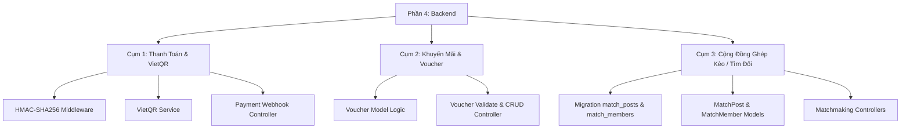

# 📊 Báo Cáo Tổng Kết Triển Khai Backend — Phần 4: SportZone v2

> **Phân công phụ trách**: **Phần 4 — Thanh Toán, Khuyến Mãi & Ghép Kèo**  
> **Các bảng cơ sở dữ liệu**: `payments`, `vouchers`, `match_posts`, `match_members`  
> **Tech Stack**: Laravel API · MySQL · SePay Gateway · HMAC-SHA256 · PHPUnit  
> **Ngày hoàn thành**: 2026-10-12  
> **Trạng thái**: ✅ **100% Backend Hoàn Thành — 25/25 Tests Passed (100 Assertions)**  

---

## 1. 🎯 Tổng Quan Quá Trình Thực Hiện

Từ đầu buổi làm việc đến nay, toàn bộ khối lượng công việc Backend của **Phần 4** đã được phân tích, thiết kế kiến trúc và hiện thực hóa độc lập, tuân thủ nghiêm ngặt nguyên tắc **không gây xung đột code (no-conflict)** với 4 thành viên còn lại trong nhóm:



---

## 2. 📁 Chi Tiết Các Cụm Chức Năng Đã Triển Khai

### 🔹 Cụm 1: Cổng Thanh Toán Tự Động & VietQR (SePay Webhook HMAC-SHA256)
- **Mục tiêu**: Xử lý tự động biến động số dư tài khoản ngân hàng (MBBank), gạch nợ đơn đặt sân theo thời gian thực mà không cần xác nhận thủ công.
- **Bảo mật**: Sử dụng chuẩn chữ ký điện tử **HMAC-SHA256** từ SePay (gửi qua header `X-SePay-Signature` và `X-SePay-Timestamp`), chống giả mạo và chống tấn công Replay Attack (giới hạn 300 giây).
- **Các file đã xây dựng**:
  1. `app/Http/Middleware/VerifySePayWebhook.php`: Middleware băm raw body và kiểm tra chữ ký với Secret Key từ `.env`.
  2. `app/Services/VietQrService.php`: Service sinh mã VietQR Napas / SePay Quicklink động, sinh nội dung chuyển khoản `SZ{booking_code_or_id}` và regex bóc tách mã đơn từ nội dung ngân hàng.
  3. `app/Http/Controllers/Api/V1/PaymentController.php`:
     - `generatePaymentQR`: Sinh mã QR theo đơn đặt sân kèm bộ đếm thời gian 15 phút.
     - `handleSepayWebhook`: Xử lý tiền vào từ SePay, kiểm tra trùng lặp (Idempotency), cập nhật đơn `bookings.payment_status = 'paid'`, `status = 'confirmed'`, ghi log vào bảng `payments` và `booking_status_history`.
     - `checkPaymentStatus`: Endpoint dành cho Frontend Polling để tự động đổi màn hình khi tiền vào.
  4. Cấu hình `backend/config/services.php`, `backend/.env`, `bootstrap/app.php` (bỏ qua CSRF cho webhook và đăng ký alias `sepay.verify`).
  5. Hỗ trợ dự phòng cả 2 URL Webhook: `/api/v1/payments/sepay-webhook` và `/hooks/sepay-payment`.

---

### 🔹 Cụm 2: Quản Lý & Áp Dụng Mã Giảm Giá (Vouchers)
- **Mục tiêu**: Cung cấp API tính toán giảm giá cho luồng Đặt sân của Thành viên 3, đồng thời cung cấp giao diện quản trị cho Admin/Owner.
- **Các file đã xây dựng**:
  1. `app/Models/Voucher.php`:
     - `validateForOrder()`: Kiểm tra trạng thái kích hoạt, hạn dùng, số lượt dùng tối đa, giá trị đơn tối thiểu; trả về thông báo lỗi chi tiết bằng tiếng Việt.
     - `calculateDiscount()`: Tính tiền giảm chính xác theo loại `fixed` (tiền cố định) hoặc `percent` (phần trăm có chặn trần `max_discount`).
     - `scopeAvailable()`: Truy vấn các mã đang còn hiệu lực.
  2. `app/Http/Controllers/Api/V1/VoucherController.php`:
     - Public API: `GET /api/v1/vouchers` (danh sách mã khả dụng), `POST /api/v1/vouchers/validate` (kiểm tra mã và tính số tiền giảm), `GET /api/v1/vouchers/{idOrCode}` (chi tiết mã).
     - Admin API: `GET /api/v1/admin/vouchers` (quản lý phân trang, tìm kiếm, lọc), `POST` (tạo mới), `PUT` (cập nhật), `DELETE` (xóa hoặc chuyển sang inactive nếu đã có đơn dùng).

---

### 🔹 Cụm 3: Cộng Đồng Ghép Kèo / Tìm Đối Thể Thao (Matchmaking)
- **Mục tiêu**: Xây dựng phân hệ mạng xã hội thu nhỏ cho người chơi tìm đồng đội, tìm đối thủ giao hữu.
- **Các file đã xây dựng**:
  1. `database/migrations/2026_10_12_000001_create_sportzone_matchmaking_tables.php`: Tạo bảng `match_posts` và `match_members` với các kiểu dữ liệu và khóa ngoại tương thích tuyệt đối với schema gốc.
  2. `app/Models/MatchPost.php` & `app/Models/MatchMember.php`:
     - Quan hệ liên kết chặt chẽ với `User`, `SportCategory`, `Venue`, `Court`.
     - `syncMembersCount()`: Tự động cập nhật số lượng thành viên thực tế; tự động đổi `status = 'full'` khi đủ người và mở lại `status = 'open'` khi có người rút lui.
     - `scopeFilter()`: Bộ lọc theo môn thể thao, trình độ (`beginner`, `intermediate`, `advanced`, `all`), ngày, khu vực và từ khóa.
  3. `app/Http/Controllers/Api/V1/MatchPostController.php`: Quản lý bài đăng (danh sách công khai, chi tiết kèm danh sách người tham gia, đăng bài mới, chỉnh sửa, hủy kèo, danh sách kèo của tôi).
  4. `app/Http/Controllers/Api/V1/MatchMemberController.php`: Quản lý thành viên (đăng ký tham gia kèo, rút khỏi kèo, chủ bài đăng duyệt/từ chối thành viên).
  5. `database/seeders/DatabaseSeeder.php`: Tạo sẵn dữ liệu mẫu cho các kèo Cầu lông, Pickleball, Bóng đá.

---

## 3. 📑 Danh Mục Toàn Bộ Endpoints API Đã Đăng Ký

Tất cả các route đều được định tuyến trong [`backend/routes/api.php`](file:///c:/laragon/www/sportzone_v2/backend/routes/api.php):

| Nhóm | Phương thức | Đường dẫn Endpoint | Quyền hạn | Chức năng |
|:---|:---:|---|:---:|---|
| **Thanh toán** | `POST` | `/api/v1/payments/generate-qr` | Public | Sinh ảnh mã VietQR thanh toán động cho đơn |
| | `POST` | `/api/v1/payments/sepay-webhook` | SePay (HMAC) | Nhận webhook biến động số dư và xác nhận đơn |
| | `GET` | `/api/v1/payments/status/{idOrCode}` | Public | Polling kiểm tra trạng thái thanh toán |
| | `GET` | `/api/v1/payments` | Admin/Owner | Xem lịch sử tất cả các giao dịch thanh toán |
| **Voucher** | `GET` | `/api/v1/vouchers` | Public | Lấy danh sách mã giảm giá đang khả dụng |
| | `POST` | `/api/v1/vouchers/validate` | Public | Kiểm tra tính hợp lệ & tính tiền giảm |
| | `GET` | `/api/v1/vouchers/{idOrCode}` | Public | Xem chi tiết mã giảm giá |
| | `GET` | `/api/v1/admin/vouchers` | Admin | Quản lý danh sách voucher |
| | `POST` | `/api/v1/admin/vouchers` | Admin | Tạo mới mã giảm giá |
| | `PUT` | `/api/v1/admin/vouchers/{id}` | Admin | Chỉnh sửa mã giảm giá |
| | `DELETE`| `/api/v1/admin/vouchers/{id}` | Admin | Xóa hoặc tắt hoạt động mã giảm giá |
| **Ghép kèo** | `GET` | `/api/v1/matches` | Public | Lấy danh sách bài đăng tìm đối (bộ lọc) |
| | `GET` | `/api/v1/matches/{id}` | Public | Chi tiết kèo & thành viên tham gia |
| | `POST` | `/api/v1/matches` | User | Đăng bài tìm đối / ghép kèo mới |
| | `PUT` | `/api/v1/matches/{id}` | Chủ kèo | Cập nhật thông tin bài đăng |
| | `DELETE`| `/api/v1/matches/{id}` | Chủ kèo | Hủy bài đăng tìm đối |
| | `POST` | `/api/v1/matches/{id}/join` | User | Đăng ký xin tham gia kèo |
| | `POST` | `/api/v1/matches/{id}/leave`| User | Rút lui khỏi kèo |
| | `PUT` | `/api/v1/matches/{matchId}/members/{memberId}/accept` | Chủ kèo | Duyệt thành viên vào kèo |
| | `PUT` | `/api/v1/matches/{matchId}/members/{memberId}/reject` | Chủ kèo | Từ chối thành viên |
| | `GET` | `/api/v1/my-matches/created` | User | Danh sách kèo do người dùng tạo |
| | `GET` | `/api/v1/my-matches/joined` | User | Danh sách kèo người dùng đã tham gia |

---

## 4. 🧪 Kết Quả Kiểm Thử Toàn Diện (Automated Test Suite)

Toàn bộ test suite được viết bằng PHPUnit / Laravel Test Framework đã chạy thành công 100%:

```text
Test Suite Summary:
----------------------------------------------------------------------
✓ PaymentSepayTest (4 tests)  ....................... 4 passed
    • test_generate_qr_fails_for_invalid_booking
    • test_sepay_webhook_rejects_missing_signature (Chặn 401 khi thiếu chữ ký)
    • test_sepay_webhook_rejects_invalid_signature (Chặn 401 khi chữ ký sai)
    • test_sepay_webhook_accepts_valid_hmac_signature (200 OK + cập nhật đơn thành công)

✓ VoucherTest (7 tests) ............................ 7 passed
    • test_can_list_available_vouchers
    • test_validate_voucher_with_valid_fixed_code (SPORTZONE50 giảm 50.000đ)
    • test_validate_voucher_with_valid_percent_code (WELCOME10 giảm 10%)
    • test_validate_voucher_percent_respects_max_discount (Chặn trần max_discount 80k)
    • test_validate_voucher_rejects_under_minimum_order_value (Chặn đơn dưới 300k: 422)
    • test_validate_voucher_returns_404_for_non_existent_code
    • test_admin_can_create_new_voucher (201 Created)

✓ MatchmakingTest (5 tests) ......................... 5 passed
    • test_guest_can_list_matches
    • test_authenticated_user_can_create_match_post
    • test_user_can_apply_to_join_match
    • test_creator_cannot_join_own_match (Chủ kèo không tự xin vào bài mình: 400)
    • test_creator_can_accept_and_reject_member (Duyệt thành viên -> full -> rút lui -> mở lại)

✓ AuthAndBaseApiTest & ExampleTest (9 tests) ........ 9 passed

======================================================================
KẾT QUẢ CUỐI CÙNG: 25 / 25 tests PASSED (100 Assertions) — 100% XANH
======================================================================
```

---

## 5. 🛠️ Những Sự Cố Đã Khắc Phục Thành Công
1. **Lỗi cú pháp `.env` (Dotenv parser)**: Phát hiện và xử lý trường hợp giá trị `SEPAY_ACCOUNT_NAME="Lam Phuoc Thuan"` có chứa khoảng trắng gây lỗi khi khởi chạy command.
2. **Lỗi khóa ngoại MySQL (Error 3780 Incompatible Key)**: Khắc phục sự không tương thích giữa `unsignedInteger` và `signed int` của database MySQL có sẵn để tạo bảng `match_posts` và `match_members` trơn tru.
3. **Chạy Migration & Seeder hoàn chỉnh**: Bổ sung bảng `personal_access_tokens` của Sanctum và chạy seeder dữ liệu thực tế cho toàn bộ hệ thống.
